# Enterprise Network Design and Security Enhancement

**Project type:** Authorised network-security simulation  
**Platform:** Cisco Packet Tracer (Cisco IOS routers and switches)  
**Focus:** Network access control, secure remote management, access-port protection, testing and troubleshooting

## 1. Project overview

This project enhances an existing multi-department network design by implementing and validating network security controls in a Cisco Packet Tracer environment. The original network provided IP addressing and connectivity among Administration, Reception/Waiting Area, CEO/CTO and shared facilities. The security enhancement focuses on three controls: an extended access control list (ACL) limiting Reception-to-CEO/CTO traffic, SSHv2 with administrative access restrictions, and sticky-MAC port security on one Administration switch port.

**Ethical scope:** All changes and tests were performed on my own simulated network, not on production systems or unauthorised devices.

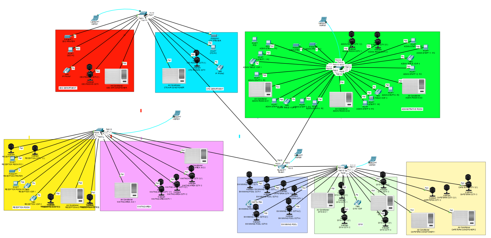

## 2. Objective

- Verify the existing IP addressing and routing functionality before making security changes.
- Restrict access from Reception/Waiting Area to the CEO/CTO subnet while permitting other traffic.
- Replace unauthenticated/insecure remote management arrangements with SSH version 2 and restrict remote management to the Administration subnet.
- Protect one end-device switch port by learning and enforcing a single authorised MAC address.
- Document before-and-after tests, configuration evidence, challenges and limitations.

## 3. Environment and tools

| Component | Details |
| --- | --- |
| Simulator | Cisco Packet Tracer |
| Router | `1ST_FLOOR_KL_BUILDING` (four routed FastEthernet interfaces) |
| Administration switch | `ADMIN_NETWORK` |
| Representative test hosts | Admin Staff 1 PC, Reception PC, CEO PC, replacement unauthorised PC |
| Verification tools | Cisco IOS CLI (`show` commands), Packet Tracer PC command prompts (`ping`, `ssh`) |

### Existing logical network layout

| Department / area | Subnet | Router gateway / interface |
| --- | --- | --- |
| Administration | `199.178.20.0/27` | `199.178.20.1` — Fa0/0 |
| Pool / Gym / Cafeteria | `199.178.20.32/27` | `199.178.20.33` — Fa1/0 |
| Reception / Waiting Area | `199.178.20.64/28` | `199.178.20.65` — Fa2/0 |
| CEO / CTO | `199.178.20.80/28` | `199.178.20.81` — Fa3/0 |

> These are the IPv4 addresses used in the original *simulation*. Because `199.178.20.0` is not RFC 1918 private address space, a future revision should renumber this lab to private ranges before reusing the design elsewhere. There was no Internet connection or default route in this lab.

## 4. Implementation method

### Phase A — Baseline verification

1. Used `show ip interface brief` and `show ip route` to verify all four router interfaces were `up/up` and the four networks appeared as directly connected routes.
2. Checked Reception PC (`199.178.20.67/28`, gateway `199.178.20.65`) and CEO PC (`199.178.20.83/28`, gateway `199.178.20.81`).
3. Confirmed **Reception → CEO PC ping succeeded (4/4 replies)** before applying the ACL. This provided baseline evidence of unrestricted routed connectivity.

### Phase B — Reception-to-CEO/CTO ACL

Added a Cisco extended ACL and applied it **inbound** to the Reception-facing router interface Fa2/0:

```cisco
access-list 101 deny ip 199.178.20.64 0.0.0.15 199.178.20.80 0.0.0.15
access-list 101 permit ip any any
interface FastEthernet2/0
 ip access-group 101 in
```

This policy denies traffic sourced from Reception/Waiting Area and destined for the CEO/CTO subnet. The explicit permit rule allows traffic to other destinations, subject to any other relevant network policy.

**Evidence:**

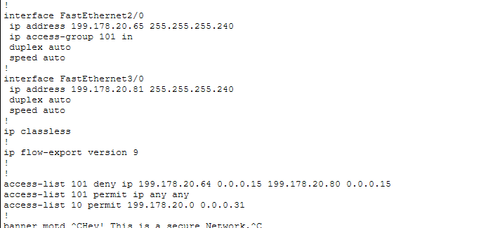

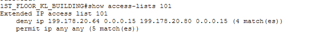

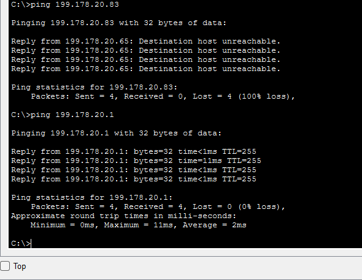

### Phase C — Secure remote administration with SSHv2

1. Set a domain name, created a local administrator account and generated **2048-bit RSA** keys.
2. Enabled **SSH version 2** and configured VTY lines with `login local` and `transport input ssh` (rather than Telnet).
3. Used a standard VTY access-class to restrict SSH management to `199.178.20.0/27` (Administration).
4. Configured a **60-second SSH authentication timeout**, **two authentication attempts**, and **five-minute console/VTY inactivity timeouts**.
5. Tested SSH from a representative Administration PC and Reception PC.

Relevant sanitised commands:

```cisco
ip domain-name portfolio.test
ip ssh version 2
ip ssh authentication-retries 2
ip ssh time-out 60
access-list 10 permit 199.178.20.0 0.0.0.31
line vty 0 4
 access-class 10 in
 exec-timeout 5 0
 login local
 transport input ssh
```

Credentials and password hashes are intentionally omitted from this public document.

**Evidence:**

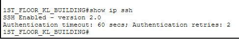

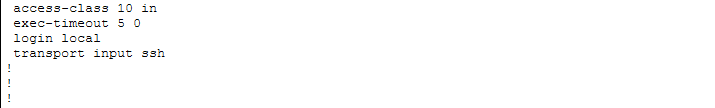

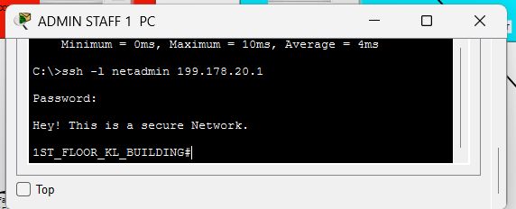

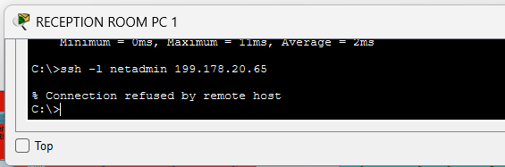

### Phase D — Administration switch port security

1. Identified the router uplink (`Fa0/18`) using `show cdp neighbors` and the Administration PC connection (`Fa0/13`) using MAC address learning and a ping test.
2. Configured port security on **Fa0/13 only**, an access port connected to Admin Staff 1 PC.
3. Enforced one allowed secure MAC, sticky learning, and `restrict` violation handling. Also enabled PortFast and BPDU Guard for this end-device-facing port.
4. Generated host traffic until the switch learned the authorised sticky MAC `00E0.B0DD.8285`.
5. In a **separate test copy** of the Packet Tracer topology, disconnected the authorised PC and connected a replacement host to Fa0/13. The switch logged a security violation from `0004.9A97.E44B`, and the replacement PC could not ping the gateway.
6. Restored the authorised PC in the main topology, verified that Fa0/13 returned to `Secure-up`, and saved the configuration.

```cisco
interface FastEthernet0/13
 switchport mode access
 switchport port-security
 switchport port-security maximum 1
 switchport port-security mac-address sticky
 switchport port-security violation restrict
 spanning-tree portfast
 spanning-tree bpduguard enable
```

**Evidence:**

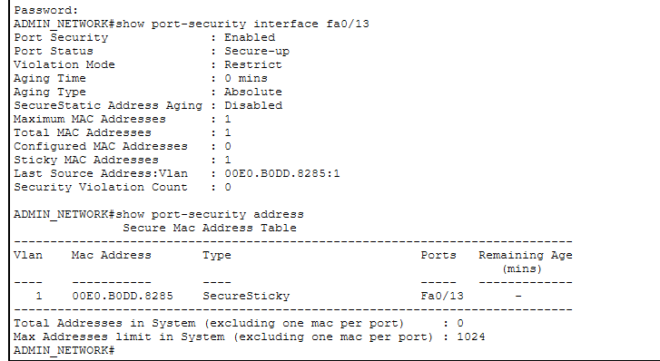

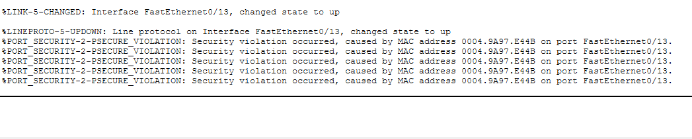

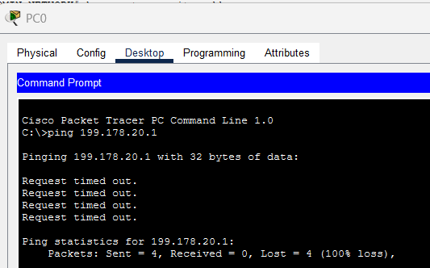

## 5. Results and evaluation

| Security test | Expected outcome | Observed result |
| --- | --- | --- |
| Reception → CEO PC **before** ACL | Reachable baseline | **4/4 ping replies**, 0% loss |
| Reception → CEO PC **after** ACL | Blocked | **0/4 replies**, 100% loss; gateway returned destination unreachable |
| Reception → Administration router gateway after ACL | Permitted | **4/4 ping replies**, 0% loss |
| Administration PC → router SSH | Login allowed | Successful SSH login, router prompt obtained |
| Reception PC → router SSH | Login refused | `% Connection refused by remote host` |
| Authorised PC on Fa0/13 | Port remains functional | One sticky MAC learned, `Secure-up`, no violations in main copy; PC → gateway **4/4** ping replies |
| Replacement host on Fa0/13 | Restrict unauthorised MAC | Violation log generated; gateway ping **0/4** replies |

The tests support the conclusion that **the configured controls worked for the specific paths and scenarios tested**. They do not demonstrate that every possible protocol, switch port, or attack path has been secured.

## 6. Troubleshooting and lessons learned

- **Verify before changing:** Confirming router routes and successful baseline pings made the ACL outcome meaningful and measurable.
- **A configured feature may not yet be operational:** Port security initially showed zero sticky MAC addresses. Generating traffic from Admin Staff 1 PC allowed the switch to learn its MAC address.
- **Physical connectivity matters:** After the replacement-device test, Fa0/13 temporarily showed `Secure-down` because it had been disconnected. Reconnecting the original PC restored `Secure-up` and successful pings.
- **Different ACLs protect different things:** Extended ACL 101 controls routed data traffic to the CEO/CTO subnet; standard ACL 10 applied to VTY lines controls who can connect for remote management.
- **Evidence should accompany claims:** CLI verification and positive/negative tests are stronger proof than simply listing configured commands.

## 7. Limitations and future improvements

- **Port-security scope:** Only **Fa0/13** was hardened and tested. Other access ports and IP-phone ports were not covered by this demonstration.
- **Flat switch VLANs:** The original topology still uses VLAN 1 on Administration switch ports; a later version could introduce separate access/voice VLANs and appropriately scoped inter-VLAN filtering.
- **Coverage of tests:** Connectivity checks primarily used ICMP and SSH, plus MAC-port enforcement. More systematic protocol-by-protocol testing would strengthen the evaluation.
- **IP address plan:** Readdress using RFC 1918 private subnet ranges in a future design.
- **Credential handling:** Replace illustrative or predictable lab passwords before distributing any device configuration. No credentials or password hashes should appear in public evidence.
- **Further hardening:** Evaluate unused port shutdown, secure device management, change control, and additional logging in a later iteration.

## 8. Packet Tracer project file

The completed and saved `Enterprise_Network_Security.pkt` file is intended to be uploaded to the **`packet-tracer/`** directory after verifying that it contains no reused credentials or personal/sensitive information. Do **not** substitute the original unmodified 2022 Packet Tracer file for the security-enhanced version. The PNG evidence in this folder documents the tested enhancements.

---

**Portfolio:** [Back to the cybersecurity portfolio homepage](../../index.md)
