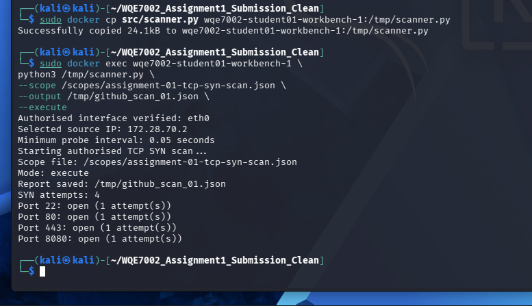
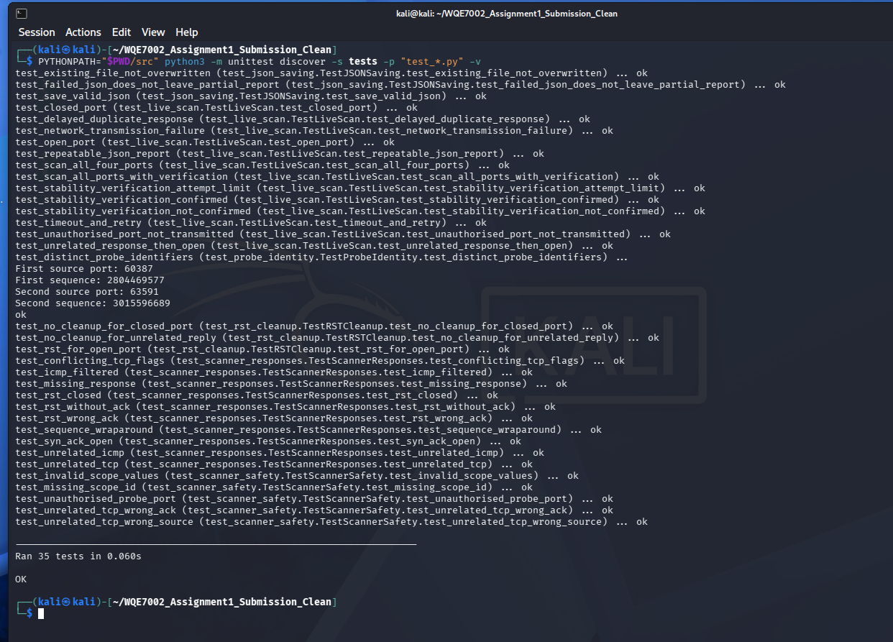
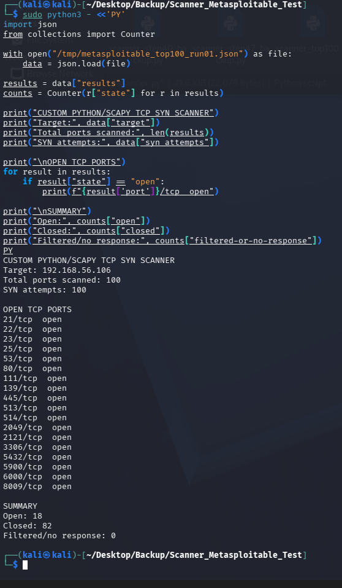

# Custom TCP SYN Port Scanner in Python (Scapy)

**Cybersecurity portfolio project 1** · Python · Scapy · Docker · TCP/IP · Network reconnaissance · Automated testing

> **Scope and provenance:** The primary implementation and automated tests are documented in an isolated, authorised WQE7002 Docker workbench. Separate personal-lab screenshots show a Metasploitable 2 scan summary and an Nmap comparison, but do not include the original scanner execution screenshot or the personal-lab scanner source. These experiments are labelled separately. See [`notes/metasploitable-evidence-status.md`](notes/metasploitable-evidence-status.md).

## Project objective

Develop a bounded TCP SYN port scanner to identify open, closed, and inconclusive TCP ports in a deliberately isolated teaching environment. Implement packet construction, response matching, cleanup, rate/attempt limits, deterministic report saving and automated tests. Compare the outcomes with an independent Nmap SYN scan.

This is a **custom TCP SYN port scanner**, **not a full replacement for Nmap**. It does not implement Nmap's service-version detection, OS fingerprinting, broad target discovery or unrestricted network scanning.

## My contribution and technologies

- **Python / Scapy:** construct TCP SYN probes, inspect TCP and ICMP responses, and send RST cleanup packets when a matching SYN-ACK arrives.
- **Response correlation:** match the returned IP addresses, source/destination ports and TCP acknowledgement number against the specific probe. Reject unrelated responses.
- **Scanning safety:** use the lecturer's trusted JSON scope, verify the required interface and target route, and enforce bounds on allowed targets, ports, rate and retry attempts.
- **Reliability:** randomise ephemeral source ports and initial TCP sequence numbers; support optional verification of initially open ports.
- **Evidence:** write JSON results without overwriting an existing report, record PCAP captures, and compare recorded outcomes with Nmap XML.
- **Testing:** 35 automated test functions cover normal responses, unrelated replies, invalid scopes, safety limits, JSON saving, duplicate/stability cases and RST cleanup.

The work was developed with disclosed AI assistance for programming, test development and explanations. Functionality was investigated using local tests, captured scan artefacts and independent Nmap comparison. These are educational results, not a claim of production readiness.

## Experiment environment and authorisation

| Parameter | Recorded authorised Docker lab |
|---|---|
| Scanner | `workbench` container (`172.28.70.2`) |
| Target | `services` container (`172.28.70.10`) |
| Interface | `eth0` |
| Permitted TCP ports | `22, 80, 443, 8080` |
| Maximum SYN rate | 20 per second |
| Maximum attempts | 2 per port |
| Timeout | 1.5 seconds |
| Lab | Isolated WQE7002 Local Docker Compose lab |

The application verifies the trusted file `/scopes/assignment-01-tcp-syn-scan.json`; its target/ports are not arbitrary command-line inputs. It refuses untrusted scope changes. Live execution requires `--execute`.

## Design and method

1. **Load and verify scope.** Confirm the supplied JSON matches the lecturer's trusted scope. Validate the target, port list, interface, probe limits and timeout.
2. **Check routing and interface.** Verify the designated interface exists and would be used to reach the authorised target.
3. **Create unique TCP probes.** Build Scapy IP/TCP SYN packets with unique ephemeral source ports and random initial TCP sequence numbers.
4. **Enforce bounds.** Send at most the authorised number of attempts while spacing probes according to the permitted rate.
5. **Classify matching responses.** Treat a matching SYN-ACK as `open`, a matching RST as `closed`, and relevant quoted ICMP unreachable messages or persistent lack of decisive response as `filtered-or-no-response`.
6. **Avoid an unfinished handshake.** For a matching SYN-ACK, send a TCP RST cleanup packet.
7. **Optionally recheck open ports.** `--verify-open` sends a second bounded SYN to initially open ports and records whether the observation is confirmed.
8. **Save output and validate.** Write timestamped JSON reports with an exclusive/no-overwrite mechanism; capture packet traces; compare port states with independent Nmap XML.

### TCP response logic (simplified)

```text
Authorised SYN probe (unique source port and sequence)
  ├─ matching SYN + ACK ─> OPEN ─> send TCP RST cleanup
  ├─ matching RST       ─> CLOSED
  ├─ relevant ICMP unreachable ─> FILTERED OR NO RESPONSE
  └─ no matching/decisive reply ─> retry within limits,
                                  otherwise FILTERED OR NO RESPONSE
```

A non-response is **not** proof that a firewall dropped the packet. Software versions and actual vulnerabilities are not determined by this scanner.

## Results from the recorded Docker workbench runs

The primary recorded live scan observed four matching SYN-ACK responses:

| TCP port | Scapy result | Independent Nmap result |
|---:|---|---|
| 22 | Open | Open |
| 80 | Open | Open |
| 443 | Open | Open |
| 8080 | Open | Open |

**Comparison:** the recorded tool output and Nmap XML agree on all four permitted ports. This supports result consistency **for this lab run only**, not general accuracy across arbitrary networks.

### Open-port stability extension

Two baseline runs and two runs with open-port verification recorded the following average measurements:

| Measurement | Baseline | With `--verify-open` |
|---|---:|---:|
| Duration | 0.5680 seconds | 0.9358 seconds |
| SYN probes per run | 4 | 8 |

The second probes confirmed all four initially open ports in the recorded verification runs. The extension increased packet traffic and execution time, so it presents a clear cost/confirmation tradeoff.

## Evidence and source files

- **Scanner implementation:** [`src/scanner.py`](src/scanner.py)
- **Automated test suite:** [`tests/`](tests/)
- **Authorised scope:** [`evidence/docker-workbench/assignment-01-tcp-syn-scan.json`](evidence/docker-workbench/assignment-01-tcp-syn-scan.json)
- **Primary JSON:** [`evidence/docker-workbench/scapy_tcp_syn_results.json`](evidence/docker-workbench/scapy_tcp_syn_results.json)
- **Primary PCAP:** [`evidence/docker-workbench/scapy_tcp_syn_capture.pcap`](evidence/docker-workbench/scapy_tcp_syn_capture.pcap)
- **Independent Nmap XML:** [`evidence/docker-workbench/nmap_tcp_syn_validation.xml`](evidence/docker-workbench/nmap_tcp_syn_validation.xml)
- **Baseline/extension JSON and captures:** see [`evidence/docker-workbench/`](evidence/docker-workbench/)
- **Original evidence hashes:** [`evidence/docker-workbench/SHA256SUMS.txt`](evidence/docker-workbench/SHA256SUMS.txt)
- **Metasploitable evidence status:** [`notes/metasploitable-evidence-status.md`](notes/metasploitable-evidence-status.md)
- **Screenshots:** [`evidence/screenshots/`](evidence/screenshots/) (Docker and personal-lab screenshots)

The `.pcap` captures can be inspected using Wireshark. PCAP and JSON artefacts contain only the supplied isolated Docker lab addresses, not live target networks.


## Screenshots from the recorded experiments

The following images are original screenshots supplied for this portfolio. They are
retained as evidence rather than reconstructed terminal output.

### A. Authorised Docker workbench

| Evidence | What it shows |
|---|---|
| [Docker environment](evidence/screenshots/docker-environment.png) | Workbench and target containers |
| [Authorised scope](evidence/screenshots/authorised-scope.png) | Course-issued target, interface and safety limits |
| [Scanner source](evidence/screenshots/scanner-source.png) | Scapy-based SYN probe implementation |
| [Automated tests](evidence/screenshots/automated-tests.png) | 35 tests completed successfully in the recorded run |
| [Scanner results](evidence/screenshots/scanner-results.png) | Four permitted ports classified open |
| [Nmap validation](evidence/screenshots/nmap-validation.png) | Independent verification of the same four ports |
| [Open-port recheck](evidence/screenshots/verify-open.png) | Repeat SYN confirmation on initially open ports |





Additional captured results:
[verification JSON part 1](evidence/screenshots/verify-open-json-part1.png) and
[verification JSON part 2](evidence/screenshots/verify-open-json-part2.png).

### B. Separate personal Metasploitable 2 host-only lab

The following screenshots document a **separate** demonstration, not the
course-issued Docker workbench scope. The author reports using a personal
custom Python/Scapy scanner variant in a virtual host-only lab.

| Evidence | What it shows |
|---|---|
| [Host-only VM network](evidence/screenshots/metasploitable-network.png) | Kali and target addresses |
| [Custom scanner's saved JSON summary](evidence/screenshots/metasploitable-results.png) | 100 ports tested: 18 open, 82 closed, 0 filtered/no-response |
| [Independent Nmap comparison](evidence/screenshots/metasploitable-nmap.png) | Nmap top-100 comparison on the lab target |
| [Scanner files present](evidence/screenshots/metasploitable-scanner-files.png) | Folder/scope file screenshot |



**Evidence limitation:** The original screenshot of the *scanner command running*
against Metasploitable 2 was not supplied. The screenshot above shows the
saved JSON being loaded and summarised, **not** the scanner execution itself.
The separate personal-lab scanner source code and its raw JSON file were also
not included in the two original code archives supplied for this portfolio.
The Docker `src/scanner.py` should not be described as the source used for the
Metasploitable scan without checking the separately adapted implementation.
A matching count between these screenshots and Nmap is a useful consistency
check, not a general performance or accuracy guarantee.

These tests used only isolated, authorised virtual networks.

## Testing and reproduction

The recorded project used **Scapy 2.7.0** in a Docker workbench with Python 3.12.3. Test files are included for reproducibility. In a compatible local environment:

```bash
python3 -m pip install -r requirements.txt
PYTHONPATH=src python3 -m unittest discover -s tests -p 'test_*.py' -v
```

The unit tests use mocked or synthetic responses and do not transmit real probes. They are not a substitute for packet-capture evidence of live behaviour.

The scanner's ordinary CLI accepts `--scope`, `--output`, an optional `--execute`, and optional `--verify-open` (only for execution). **Do not run live scans outside the authorised workbench.** Its trusted scope path is fixed to the lecturer's teaching environment, so simply changing a supplied scope file will not make a different target work.

## Troubleshooting and lessons learned

- **Probe identity matters.** A SYN-ACK alone is insufficient if its IP/port fields or acknowledgement number do not match the sent probe.
- **One response is not always conclusive.** Matching RST/ICMP evidence and absence of response have different meanings, and ambiguous outcomes must be labelled carefully.
- **Scope enforcement is part of the tool design.** The scanner validates the environment and requires explicit opt-in to transmit SYNs.
- **Evidence is more credible than claims.** Independent Nmap output, test files, JSON and packet captures make the reported behaviour reviewable.

## Limitations and improvements

- Evaluated on four approved TCP ports in one isolated Docker topology; no claims about internet-facing targets or wide-scale detection accuracy.
- `filtered-or-no-response` deliberately combines distinct possibilities; future work could make uncertainty reporting more informative.
- Version identification and vulnerability validation are **outside the scanner's implemented features**.
- Two runs per mode are too few to draw strong conclusions about reliability or performance.
- A future authorised extension could compare repeatability across several controlled network conditions and report latency distributions.
- The personal Metasploitable 2 test is supported by screenshots of saved results and an Nmap comparison; its scanner execution screenshot, source file and raw JSON are not yet included.

## Responsible use

This project documents educational security research conducted in an authorised, isolated lab. Do not aim network scans at devices or networks without permission. No personal credentials or identification numbers are published in this portfolio package.
